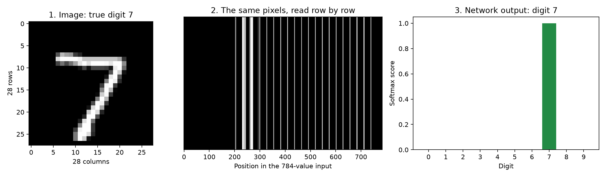
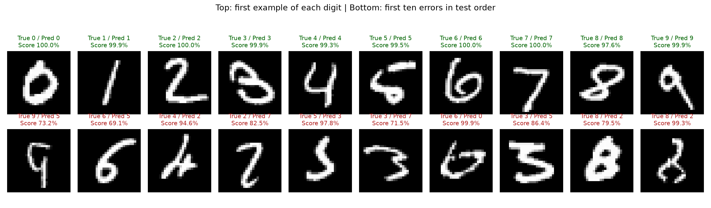
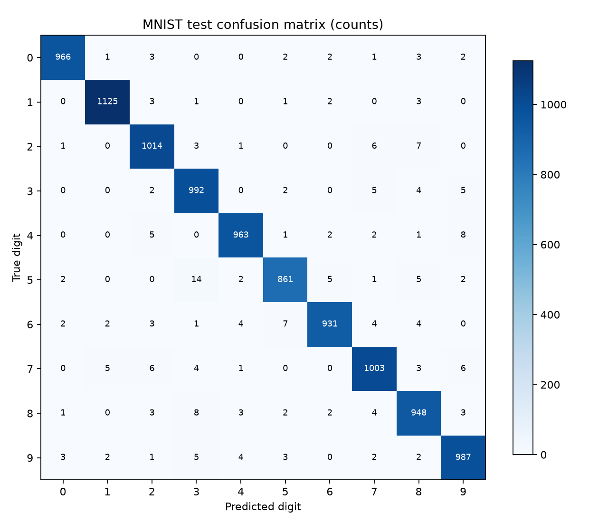
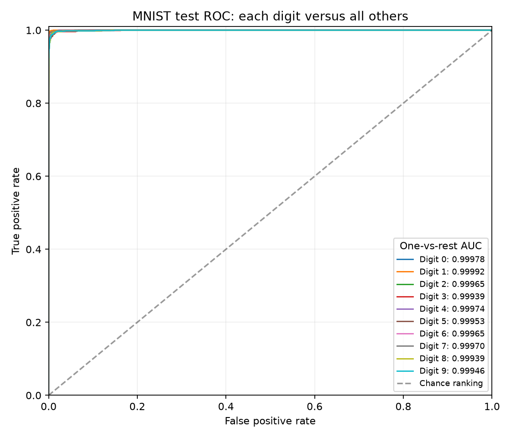
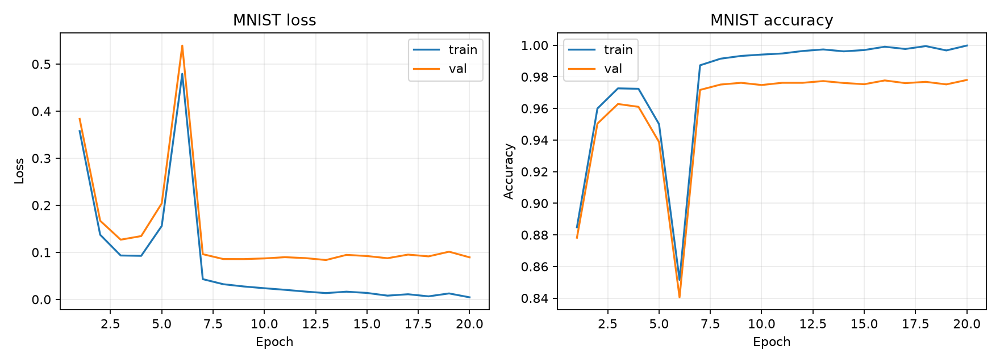

# MLP from Scratch: MNIST

A small neural network, built one calculation at a time, to understand how learning actually happens.

## Why we built this

This project began as a first-year college assignment. We wanted to learn the foundations of machine learning and neural networks well enough to explain what happens between an image going in and a prediction coming out. Recognizing handwritten digits gave us a concrete problem: the inputs are easy to look at, the answers are familiar, and the mistakes are worth examining.

Our goal is to connect the mathematics to working code. What does a weight do? How does the loss tell us that a prediction is wrong? How can a derivative tell thousands of parameters how to change? Implementing these steps ourselves makes those questions visible in the code instead of leaving them inside a library call.

The model uses Python and NumPy for every learning operation. There is no automatic differentiation, deep learning framework, or scikit-learn model behind it. Matplotlib draws the figures. We chose a modest MLP so that we could understand its behavior, test its gradients, and reproduce an experiment from beginning to end.

## From pixels to a digit



1. **Read the pixels.** An MNIST image is a 28×28 grid. Each pixel records brightness: dark pixels are near zero and bright strokes are near one after normalization.
2. **Put them in order.** We read the rows in sequence to create a vector of 784 numbers. The position of each pixel stays consistent across images. Flattening does not remove the values, but the MLP has no built-in notion of neighboring pixels as a convolutional network does.
3. **Combine the evidence.** Two hidden layers combine these numbers using learned weights. ReLU adds a nonlinear step, allowing the network to learn more complex combinations than a single linear rule. We do not manually program rules such as “a closed loop means zero,” and this diagram is an input/output illustration, not an explanation of individual hidden neurons.
4. **Choose an answer.** The final layer produces ten scores. Softmax turns them into values that sum to one, and the largest value determines the predicted digit. During training, the known answer and the loss guide small updates to the weights through backpropagation.

The architecture is **784 → 128 → 64 → 10**, with **109,386 trainable parameters**. Softmax scores describe this model's outputs; a score of 99% is not a guarantee that the model is correct or well calibrated.

## What the model achieved

These measurements come from one complete run: 20 epochs, SGD with learning rate 0.1, batch size 64, and seed 42. We trained on 50,000 images, used 10,000 for validation, and evaluated the selected checkpoint on the 10,000 official test images. There was no deskewing or data augmentation. The best checkpoint was selected by **validation loss at epoch 13**, before test evaluation.

| Measurement | Test result | How to read it |
|---|---:|---|
| Accuracy | **97.90%** | 9,790 correct predictions out of 10,000 |
| Error rate | 2.10% | 210 images were classified incorrectly |
| Cross-entropy loss | 0.072777 | Measures the scores assigned to the correct answers; lower is better |
| Macro precision | 97.90% | Average precision across the ten digits, with equal weight per digit |
| Macro recall | 97.87% | Average fraction of each digit that was correctly recognized |
| Macro F1 | 97.88% | Balances precision and recall, with equal weight per digit |
| Weighted F1 | 97.90% | Weights each digit's F1 by its number of test examples |
| Macro ROC AUC, one-vs-rest | **0.999621** | Average ranking performance across the ten digit-versus-rest tasks |
| Micro ROC AUC, one-vs-rest | 0.999617 | Ranking performance after pooling all image/class pairs |
| Approximate 95% accuracy interval | 97.60–98.16% | Wilson interval for this fixed model's test predictions |

The interval describes finite-test-sample uncertainty under a binomial sampling assumption. It does not measure variation across training seeds, dataset shift, or the uncertainty of an individual prediction. This is one run, so we do not claim a multi-run average or statistical superiority over another model. Full values, per-digit metrics, and the checkpoint hash are in [the machine-readable report](docs/baseline_metrics.json).

<details>
<summary>Results for each digit</summary>

| Digit | Test images | Precision | Recall | F1 | ROC AUC (OvR) |
|---|---:|---:|---:|---:|---:|
| 0 | 980 | 99.08% | 98.57% | 98.82% | 0.99978 |
| 1 | 1,135 | 99.12% | 99.12% | 99.12% | 0.99992 |
| 2 | 1,032 | 97.50% | 98.26% | 97.88% | 0.99965 |
| 3 | 1,010 | 96.50% | 98.22% | 97.35% | 0.99939 |
| 4 | 982 | 98.47% | 98.07% | 98.27% | 0.99974 |
| 5 | 892 | 97.95% | 96.52% | 97.23% | 0.99953 |
| 6 | 958 | 98.62% | 97.18% | 97.90% | 0.99965 |
| 7 | 1,028 | 97.57% | 97.57% | 97.57% | 0.99970 |
| 8 | 974 | 96.73% | 97.33% | 97.03% | 0.99939 |
| 9 | 1,009 | 97.43% | 97.82% | 97.63% | 0.99946 |

Precision asks how often a prediction of that digit is correct. Recall asks how many actual examples of that digit are found. F1 balances the two. OvR means one-versus-rest.

</details>

### Looking at the mistakes



The top row contains the first test example of each digit; the bottom row contains the first ten mistakes in test order. We used this fixed rule rather than selecting only visually pleasing examples. Some errors receive very high scores, which is a useful reminder that confidence and correctness are different things.



Rows show the true digit and columns show the prediction. Most counts sit on the diagonal. The most frequent directed mistake was **5 predicted as 3**, with 14 cases. Digit 8 had the lowest F1 (97.03%); digit 5 had the lowest recall (96.52%). These observations help describe this checkpoint, but they were not used to retune it on the test set.

### What ROC and AUC add



For digit 7, for example, we treat every 7 as positive and all other digits as negative, then vary a threshold on the model's score for 7. The ROC curve plots the fraction of true 7s detected against the fraction of other digits incorrectly accepted as 7s. We repeat this for all ten digits. AUC summarizes each curve; random ranking corresponds to 0.5 and perfect ranking to 1.

AUC is high here because most positive/negative pairs are well ordered. Accuracy asks a different question: did the correct digit receive the highest score among all ten? One-vs-rest AUC can be very high even when some competing digits are confused. It also does not establish probability calibration. The ROC implementation uses probability scores, groups tied thresholds, and integrates with trapezoids; it does not calculate AUC from predicted class IDs.

### How learning evolved



Training performance continued improving after validation loss reached its minimum. At the selected epoch, training accuracy was 99.73% and validation accuracy was 97.73%. Later epochs did not improve validation loss consistently. The temporary spikes early in training and the later gap suggest that a smaller learning rate or a schedule and regularization would be reasonable future validation experiments. They were not applied retroactively to this result.

## How this compares with other MNIST models

The table provides historical context, not a controlled leaderboard. The literature results below were reported by their authors; we did not reimplement those models. Accuracy is calculated as 100% minus the published error rate.

| Model | Test error ↓ | Accuracy ↑ | Important context | Source |
|---|---:|---:|---|---|
| **This NumPy MLP, 128 + 64 hidden units** | **2.10%** | **97.90%** | 50k training / 10k validation; no augmentation | [Recorded run](docs/experiments.md) |
| Fully connected MLP, 300 + 100 hidden units | 3.05% | 96.95% | Historical architecture/training recipe; 60k training pool | [LeCun et al., 1998, Fig. 9](https://leon.bottou.org/publications/pdf/ieee-1998.pdf) |
| Fully connected MLP, 500 + 150 hidden units | 2.95% | 97.05% | Historical architecture/training recipe; 60k training pool | [LeCun et al., 1998, Fig. 9](https://leon.bottou.org/publications/pdf/ieee-1998.pdf) |
| Linear classifier | 12.00% | 88.00% | Historical baseline on regular images | [LeCun et al., 1998, Sec. III](https://leon.bottou.org/publications/pdf/ieee-1998.pdf) |
| LeNet-5 convolutional network | 0.95% | 99.05% | Uses spatial structure; published result without distortions | [LeCun et al., 1998, Fig. 9](https://leon.bottou.org/publications/pdf/ieee-1998.pdf) |
| Large, deep MLP | 0.35% | 99.65% | Many more neurons/layers and deformed training images | [Cireșan et al., 2010](https://arxiv.org/abs/1003.0358) |

Different training pools, losses, optimizers, preprocessing, and model sizes prevent attributing these gaps to architecture alone. These are selected historical references, not current state-of-the-art claims. Our result shows that a relatively small dense network can learn useful digit patterns; the larger MLP and LeNet results also show that there is considerable room beyond this baseline. We do not list external ROC AUC values because these references do not provide comparable values for those reported experiments.

## What we would explore next

We would first compare several seeds and learning-rate settings on validation data, then investigate regularization and augmentation. A convolutional network would be a useful follow-up to study how preserving spatial structure changes learning. Any model developed after examining these test diagnostics should treat the public MNIST test results as exploratory rather than a new untouched test; a fresh held-out evaluation would be needed for stronger claims.

## Installation

Python 3.10 or newer is required. Run commands from the repository root.

```bash
git clone https://github.com/jp-tedesco/MLP-from-Scratch.git
cd MLP-from-Scratch
python -m venv .venv
```

Activate the environment on Windows PowerShell:

```powershell
.\.venv\Scripts\Activate.ps1
```

Or on Linux/macOS:

```bash
source .venv/bin/activate
```

```bash
python -m pip install -r requirements.txt
```

If PowerShell activation is restricted, use `.\.venv\Scripts\python.exe` instead of `python`. Dependencies use compatible version ranges; each run records Python and NumPy versions. To capture the exact environment, run `python -m pip freeze > results/environment.txt`.

## Training

```bash
python scripts/train.py --epochs 20 --batch-size 64 --learning-rate 0.1 --seed 42 --output-dir results/my-run
```

The initial run downloads approximately 12 MB of gzip files. A default split contains 50,000 training, 10,000 validation, and 10,000 test images. Inputs are flattened to 784 float32 values in `[0, 1]`. Labels remain integer class indices. The training command loads the test partition through the dataset interface but never computes test metrics or uses test data to select parameters.

The output directory must be empty, preventing accidental overwrites.

The recorded experiment and its trained checkpoints are already included in [results/baseline/](results/baseline/). Use a different directory, as in the command above, for new training runs. See [the results guide](results/README.md) to evaluate the published checkpoint directly.

A successful run creates:

| Artifact | Purpose |
|---|---|
| `config.json` | Settings, sample counts, and environment versions |
| `history.csv` | Epoch loss, accuracy, and elapsed seconds |
| `best_model.npz` | Parameters with the lowest validation loss |
| `last_model.npz` | Parameters from the final epoch |
| `summary.json` | Selected epoch and its recorded metrics |
| `learning_curves.png` | Training and validation curves |

The training accuracy and loss are recomputed at the end of each epoch, using the same parameters as the validation metrics. This costs an extra inference pass but makes curves comparable. Accuracy values in exported files are fractions, not percentages.

For a short integration run, use a new directory:

```bash
python scripts/train.py --epochs 2 --train-limit 2000 --output-dir results/smoke
```

Other options include `--hidden-sizes 256 128`, `--validation-size 10000`, `--no-download`, and `--no-plot`. Use `--hidden-sizes` with no values for a linear Softmax classifier. See `python scripts/train.py --help` for details. Subset runs verify the pipeline; they do not represent a full-data benchmark.

## Final evaluation

Freeze architecture and hyperparameters using validation, then evaluate the selected checkpoint:

```bash
python scripts/evaluate.py --model results/my-run/best_model.npz --output results/my-run/test_metrics.json --no-download
```

Evaluation prints test loss, accuracy, and a confusion matrix (rows are true classes, columns are predicted classes). Output files must not already exist. Do not repeatedly tune settings using test scores.

It also exports per-class precision/recall/F1, macro and micro one-vs-rest AUC, and a Wilson accuracy interval. To regenerate the visual report for a newly trained run:

```bash
python scripts/evaluate.py --model results/my-run/best_model.npz --output results/my-run/detailed_metrics.json --figures-dir results/my-run/figures --history results/my-run/history.csv --no-download
```

The committed figures in `docs/assets/` belong to the recorded baseline. This command writes new figures into the new run directory. Published raw metrics are in `docs/baseline_metrics.json`, and the original trained weights and run artifacts are included in `results/baseline/`.

## Architecture and mathematics

Default network: `784 → Dense(128) → ReLU → Dense(64) → ReLU → Dense(10)`.

For a batch of `B` examples, a dense layer computes `Z = A @ W + b`. Weights have shape `(n_in, n_out)` and biases `(1, n_out)`. Hidden-layer weights use He normal initialization, with standard deviation `sqrt(2 / n_in)`; the linear output uses Xavier normal initialization, `sqrt(2 / (n_in + n_out))`. All biases start at zero.

The network returns logits. The loss combines Softmax and cross-entropy from logits using a shifted log-sum-exp calculation. For logits `z` and class `y`, per-example loss is `log(sum(exp(z - max(z)))) - (z[y] - max(z))`. This avoids taking the logarithm of a probability that may have underflowed to zero.

The combined mean-loss derivative is `dZ = (P - Y) / B`, where `Y` is one-hot. Integer labels use indexing to avoid constructing `Y`. For each dense layer:

```text
dW = A_previous.T @ dZ
db = sum(dZ, axis=0, keepdims=True)
dA_previous = dZ @ W.T
```

ReLU multiplies the incoming derivative by `(Z > 0)`, choosing derivative zero at zero. The division by `B` happens once in the loss. All gradients are computed before SGD updates `parameter -= learning_rate * gradient`.

## Python API

```python
import numpy as np
from src.mlp.network import MLP
from src.mlp.losses import CrossEntropyLoss
from src.mlp.optimizers import SGD

model = MLP((784, 128, 64, 10), seed=42)
loss = CrossEntropyLoss()
optimizer = SGD(learning_rate=0.1)
x = np.zeros((2, 784), dtype=np.float32)
y = np.array([0, 1])
logits = model.forward(x, training=True)
value = loss.forward(logits, y)
model.backward(loss.backward())
optimizer.step(model.parameters())
probabilities = model.predict_proba(x)
```

Inference preserves pending training caches. Training caches and gradients are overwritten each batch. Checkpoints store architecture and parameters, not RNG state or trainer state: loading supports inference or a fresh training run, not an exact interrupted-run resume.

## Project structure

```text
src/data/mnist.py       # Download, parsing, normalization, stratified split
src/mlp/activations.py  # ReLU and stable Softmax
src/mlp/layers.py       # Dense forward/backward and parameters
src/mlp/losses.py       # Stable categorical cross-entropy
src/mlp/metrics.py      # Accuracy, precision/recall/F1, ROC/AUC, Wilson interval
src/mlp/reporting.py    # Real digit examples and diagnostic figures
src/mlp/network.py      # Architecture, prediction, serialization
src/mlp/optimizers.py   # SGD
src/mlp/trainer.py      # Mini-batch training and batched evaluation
scripts/train.py       # Training CLI and artifact export
scripts/evaluate.py    # Test evaluation CLI
tests/                 # Numerical, data, and integration tests
docs/project_plan.md   # Implementation milestones
docs/experiments.md    # Experiment protocol and measured results
```

## Verification and troubleshooting

```bash
python -m unittest discover -s tests -v
```

Tests include finite differences in float64, extreme logits, invalid inputs, synthetic learning, IDX corruption detection, and serialization round trips. Seeds control initialization, splitting, and shuffling. Different NumPy/BLAS versions or thread counts may still produce slightly different floating-point results.

The latest local review passed **24 tests**, including known AUC examples, tied scores, absent-class handling, partial mini-batches, and checkpoint selection. Training inputs and all labels are checked before the first parameter update, and invalid learning rates are rejected before downloading data or creating run files. Review notes are in [docs/review.md](docs/review.md).

If loss becomes nonfinite, check data and decrease the learning rate. If learning stalls, verify gradients with the test suite and try overfitting a tiny subset. Diverging train/validation curves may indicate overfitting. CPU performance depends on the NumPy BLAS build; limiting BLAS threads can help small matrix multiplications (for example, set `OPENBLAS_NUM_THREADS=1` before starting Python).

The project provides a tested local training and inference pipeline. Deployment as a hosted service, monitoring, and input-image acquisition are outside its scope. External images must match MNIST preprocessing: 28×28 grayscale, dark background, bright foreground, and the same flattening order.

## Dataset reference

MNIST was created by Yann LeCun, Corinna Cortes, and Christopher J. C. Burges. Downloads use the [CVDF MNIST mirror](https://github.com/cvdfoundation/mnist), which documents the original partitions and IDX format, with an OSSCI mirror fallback. Published MD5 hashes detect file corruption; TLS authenticates the download connection.

## License

The original project code and documentation are available under the [MIT License](LICENSE), allowing reuse with the copyright and license notice preserved. MNIST and the digit examples derived from it are credited to their dataset authors; this repository does not claim to relicense the underlying dataset. Downloaded dataset files are kept outside Git.
