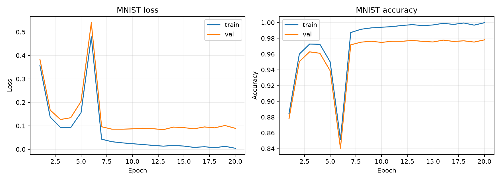

# Recorded results

The `baseline/` directory contains the complete recorded MNIST run, including
the trained weights. These artifacts are versioned so a fresh clone can inspect
the experiment or evaluate the model without training again.

| File | Contents |
|---|---|
| `baseline/best_model.npz` | Checkpoint selected by validation loss at epoch 13 |
| `baseline/last_model.npz` | Final checkpoint after epoch 20 |
| `baseline/config.json` | Hyperparameters, sample counts, and environment versions |
| `baseline/history.csv` | Training and validation metrics for all 20 epochs |
| `baseline/summary.json` | Selected epoch and its training/validation metrics |
| `baseline/test_metrics.json` | Original test loss, accuracy, and confusion matrix |
| `baseline/extended_metrics.json` | Precision, recall, F1, ROC AUC, and accuracy interval |
| `baseline/learning_curves.png` | Training and validation learning curves |



The selected model reached **97.90% test accuracy**, **97.88% macro F1**, and
**0.999621 macro one-vs-rest ROC AUC**. See [the experiment record](../docs/experiments.md)
for the evaluation protocol and limitations. Directory paths in the published
configuration use repository-relative notation for portability.

Evaluate the published checkpoint from the repository root:

```bash
python scripts/evaluate.py --model results/baseline/best_model.npz --output results/published_evaluation.json
```

MNIST is downloaded on the first evaluation if it is not cached. Use a new
output filename if the report already exists. The selected checkpoint's SHA-256
is `6f1bdd538dde0196afb3828915144721ea5a4b6606c9c8a8d72ad2453b5bfe4d`.

To run a new training experiment, choose an empty directory such as
`--output-dir results/my-run`. Other result directories and new reports remain
ignored by Git unless explicitly selected for publication.
